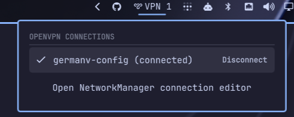

# OpenVPN Plugin for Omarchy

A plugin for [Omarchy](https://omarchy.org/) to manage NetworkManager OpenVPN connections with quick connect and disconnect actions.

## Installation

1. Install the plugin using the Omarchy CLI:
   `omarchy plugin add https://github.com/GermanViter/omarchy-openvpn`
2. Restart Omarchy shell:
   `omarchy restart shell`

## Removal

To remove the plugin, run:
`omarchy plugin remove germanviter.openvpn`

## Usage

Use the plugin in your Omarchy bar to connect and disconnect from your OpenVPN profiles.
